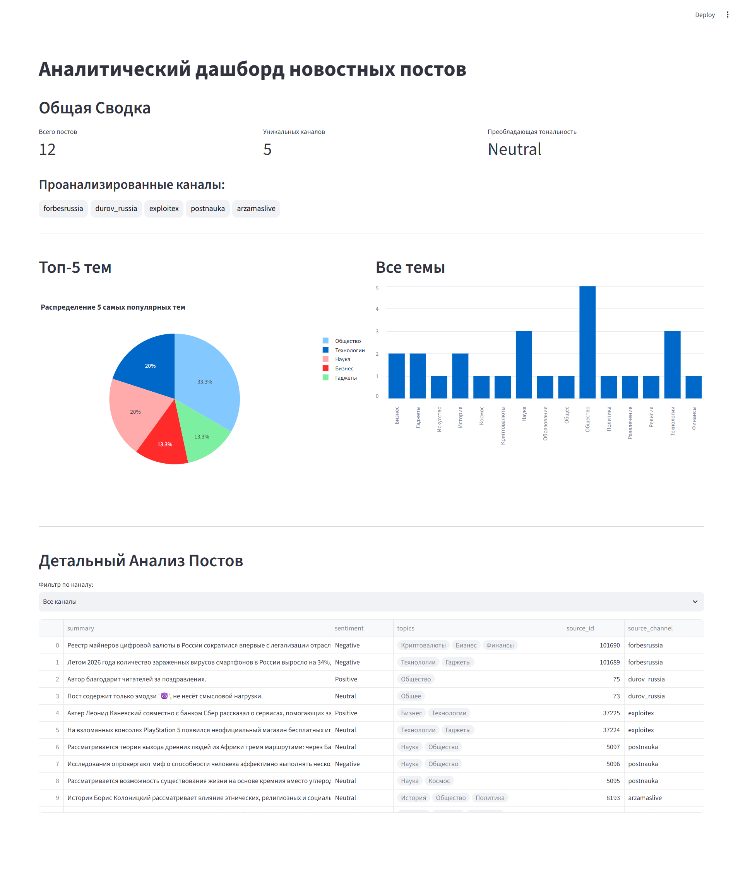

# TARS (Telegram Analytic & Reporting System)

**TARS** — это комплексный ETL-пайплайн, который в реальном времени собирает новостные посты из Telegram-каналов, производит их глубокий анализ с помощью AI-модели GigaChat и визуализирует полученные инсайты на интерактивном дашборде.



## 🚀 Ключевые Возможности

*   **Автоматический Сбор Данных:** Асинхронное извлечение постов из неограниченного числа публичных Telegram-каналов с помощью Telethon.
*   **Глубокий AI-Анализ:** Каждый пост анализируется по нескольким векторам:
    *   **Суммаризация:** Краткая выжимка ключевой информации.
    *   **Анализ Тональности:** Определение сентимента (Positive, Negative, Neutral).
    *   **Тематическая Классификация:** Присвоение посту категорий из заранее определенного списка для унификации данных.
*   **Интерактивная Визуализация:** Динамический дашборд на базе Streamlit, позволяющий в реальном времени исследовать данные с помощью интерактивных графиков (Plotly) и фильтров.
*   **Надежная Архитектура:** Модульная структура кода, безопасное управление API-ключами через переменные окружения и отказоустойчивая обработка ошибок API.

## 🛠️ Технологический Стек

| Компонент | Технология |
|:--- |:---|
| **Язык** | Python 3.10+ |
| **Визуализация** | Streamlit, Plotly |
| **Анализ данных** | Pandas |
| **Telegram API** | Telethon |
| **AI Модель** | GigaChat API |
| **Сетевые запросы** | Requests |
| **Конфигурация** | python-dotenv |


## 🖇️ Разработка с ИИ-ассистентом
Проект реализован в парадигме "AI-assisted development" с использованием ИИ-ассистента (Gemini). Этот подход был выбран сознательно, чтобы отразить современный рабочий процесс, в котором аналитик данных выступает в роли архитектора и стратега, а ИИ — в роли мощного инструмента для ускорения разработки.

*   **Роль человека:** Постановка бизнес-задачи, проектирование архитектуры решения, критический аудит и отладка сгенерированного кода, интерпретация результатов.
*   **Роль ИИ-ассистента:** Генерация кода по четкому ТЗ, объяснение синтаксиса и концепций, прототипирование различных подходов, помощь в поиске и устранении ошибок.


## 🏗️ Архитектура Конвейера

Проект построен по классической ETL-схеме с четким разделением модулей по их ответственности:

`[Telegram API]` -> `telegram_core.py` **(Extract)** -> `main.py` **(Orchestrate)** -> `ai_core.py` **(Transform)** -> `[GigaChat API]` -> `dashboard_core.py` **(Load/Present)**

## ⚙️ Установка и Запуск

### 1. Клонирование репозитория
```bash
git clone https://github.com/kadence-init/telegram-insight-pipeline.git
cd telegram-insight-pipeline
```

### 2. Создание и активация виртуального окружения
```bash
# Для Windows
python -m venv venv
venv\Scripts\activate

# Для macOS/Linux
python3 -m venv venv
source venv/bin/activate
```

### 3. Установка зависимостей
```bash
pip install -r requirements.txt
```

### 4. Конфигурация
Для работы проекта необходимо предоставить API-ключи.

1.  Создайте в корневой папке проекта файл `.env`.
2.  Скопируйте в него содержимое из файла-шаблона `.env.example`.
3.  Заполните `.env` вашими реальными ключами.

```dotenv
# .env файл
TELEGRAM_API_ID=ВАШ_ID
TELEGRAM_API_HASH=ВАШ_ХЭШ
GIGACHAT_API_KEY=ВАШ_КЛЮЧ_GIGACHAT
```

### 5. Запуск приложения
```bash
streamlit run main.py
```
При первом запуске `telethon` попросит вас авторизоваться в терминале (ввести номер телефона, код из Telegram и, возможно, пароль двухфакторной аутентификации). После этого будет создан файл сессии `*.session`, и повторная авторизация не потребуется.

## 📈 Планы по Развитию

- [ ] **Реализация автоматического фактчекинга** (сравнение ключевых тезисов поста с данными из внешних, доверенных источников).
- [ ] Перенос результатов анализа в базу данных (SQLite/PostgreSQL) для постоянного хранения.
- [ ] Развитие дашборда: добавление фильтров по датам, темам и тональности.
- [ ] Внедрение асинхронных запросов к AI API для параллельной обработки постов.
- [ ] Упаковка проекта в Docker-контейнер для упрощения развертывания.
